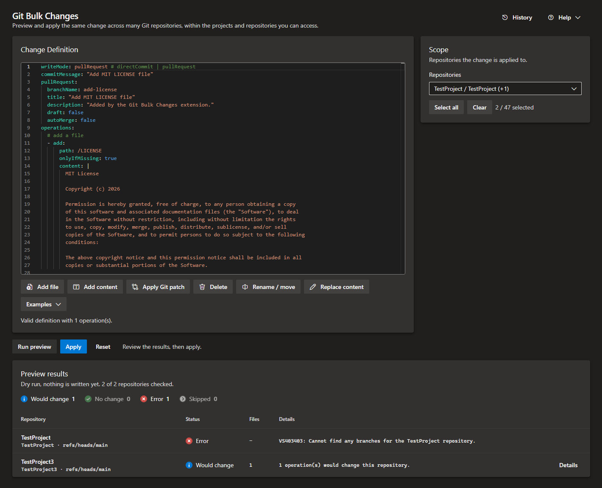

# Azure DevOps Git Bulk Changes

An Azure DevOps extension that lets users perform bulk changes in Git repositories across an organization.



## What it does

The extension adds a **Git Bulk Changes** page to the collection settings. Pick the repositories you
want to change, describe the change once, and preview it across every selected repository before writing anything.

The preview is a read-only dry run: it reads each repository, applies the operations in memory and
shows a per-repository status (`Would change`, `No change`, `Skipped`, `Error`) together with the
exact unified diff and the reason for every skipped or failed repository. Only after you review the
preview can you apply the changes.

## How it works

1. **Pick the scope.** Select the repositories to change from a single filterable list that spans every project you can access (each entry is labelled with its project). The list only contains repositories the signed-in user can read, so filtering matches across all of them at once.
2. **Describe the change once.** A definition is a small YAML document: an ordered list of operations plus how the result should be written (`writeMode`, `commitMessage`, `pullRequest`, and an optional target `branch`).
3. **Preview.** The preview is a read-only dry run. Each repository is read, the operations are applied in memory, and you get a per-repository status with the exact unified diff and a specific reason for anything skipped or failed. Diffs are computed locally and never sent to Azure DevOps.
4. **Apply.** Only after reviewing the preview and accepting the changes, they are written to the repositories. If any repository cannot be updated, it is skipped with a reason, and the rest continue independently.

If you want to learn more about the inner workings, read about the [architecture and design](docs/architecture.md) of the extension.

### Example definition

```yaml
writeMode: pullRequest # directCommit | pullRequest
commitMessage: "Add MIT LICENSE file"
pullRequest:
  branchName: add-license
  title: "Add MIT LICENSE file"
  description: "Added by the Git Bulk Changes extension."
  draft: false
  autoMerge: false
operations:
  # add a file
  - add:
      path: /LICENSE
      onlyIfMissing: true
      content: |
        MIT License
        ...
  # change file content
  - replace:
      path: /azure-pipelines.yml
      find: "pool: Azure"
      replace: 'pool: { name: "Self-Hosted", vmImages: AzureVMImage }'
      onNoMatch: skip # error | skip | createIfMissing
```

The extension provides a few example definitions as a starting point. Adding additional operations is straightforward and can be done by using the buttons below the editor.

### Regex replacements

By default, `replace` treats `find` as a literal string. Set `useRegex: true` to use a JavaScript regular expression. The engine replaces every match (the global flag `g` is added automatically). In the replacement string, `$1` and `$2` refer to numbered capture groups, `$<name>` refers to a named group, and `$&` inserts the complete match.

```yaml
- replace:
    path: /azure-pipelines.yml
    find: 'pool=(?<name>\w+)'
    replace: "pool[$<name>]"
    useRegex: true
    flags: i
```

For example, `POOL=linux` becomes `pool[linux]`.

## Getting started

### 1. Install the extension

Install [**Git Bulk Changes** from the Visual Studio Marketplace](https://marketplace.visualstudio.com/items?itemName=namoshek.ado-git-bulk-changes) into your Azure DevOps organization.

### 2. Perform your first bulk change

To perform your first bulk change, follow these steps:

- Open the collection settings from the project overview.
- Choose **Git Bulk Changes** from the settings menu (section "Extensions").
- Fill out the form, preview the changes, and apply them to the selected repositories.

## Permissions

The extension requests the following OAuth scopes on behalf of the signed-in user:

| Scope            | Purpose                                                                      |
| ---------------- | ---------------------------------------------------------------------------- |
| `vso.code`       | Required to read repositories and their contents                             |
| `vso.code_write` | Required to write changes to repositories (create commits and pull requests) |
| `vso.project`    | Required to read accessible projects (required for listing repositories)     |

All calls go directly to the Azure DevOps REST API with the signed-in user's OAuth token. There is no server component and no service principal. Since the extension only lives in an iframe in the browser, it cannot perform any actions beyond what the signed-in user is permitted to do and it will never leak any data to a third party.

## Development

### Local Development & Hot Reloading

For local development with hot-realoading, run `npm start` to launch the Webpack Dev Server and host the extension from `localhost:3000`.
To sideload the extension into Azure DevOps, you need to serve it over HTTPS. The easiest way to do this is with a self-signed development certificate.
You can create and trust a self-signed certificate with this command: `npm run create-dev-cert` (requires the .NET SDK to be installed).
This creates `dev.crt` and `dev.key` files in the project root, which are used by the `webpack.config.js` for HTTPS hosting.

To build an extension package for local development, run `npm run package:dev` which uses `vss-extension.dev.json` to override the manifest and point to the local development server

### Build

```sh
npm install
npm run build
```

### Run linter & tests

```sh
npm run lint
npm run test
```

### Package the extension

```sh
npm run package
```

This produces a `.vsix` file that can be uploaded to the Marketplace or installed directly into an Azure DevOps Server instance.

Note: The extension is packaged and published to the Visual Studio Marketplace automatically when a GitHub release is created.

### Development Resources

- [Azure DevOps Design System](https://developer.microsoft.com/en-us/azure-devops/)

## License

The MIT License (MIT). Please see [License File](LICENSE.md) for more information.
