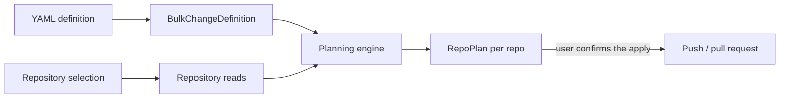

# Extension Architecture

One YAML definition describes a set of file changes; the extension computes and applies that same
change set across many repositories. Three phases: **define → preview → apply**.

## 1. The definition

- The YAML document is the single source of truth: write mode, target branch, commit message and pull-request settings all live in it.
- A `writeMode` of `directCommit` pushes straight to the branch; `pullRequest` opens a PR into it.
- Multiple operation kinds: `add`, `addContent`, `applyPatch`, `delete`, `rename`, `replace`, each with specialized behavioral switches (missing file, no match, idempotency, recursion).
- Parsing and validation happen once, on every edit: unknown keys are rejected, defaults are filled in, and paths, branch names and patches are checked before anything runs. An invalid definition is never applied.

## 2. Calculating the changes

For each repository, planning is a read-only round trip:

1. **Collect the touched paths:** The definition yields the literal paths its operations name; the paths inside a `applyPatch` are read out of the patch itself. Top-level directories are added too, so one definition can target a file that only some repositories contain.
2. **Read the base state:** Resolve the target branch to a commit, then fetch only the touched paths at that exact commit. Binary or oversized files are kept as placeholders, not errors.
3. **Apply the operations in memory:** The repository subset is loaded into a virtual workspace and each operation mutates it in order, producing one per-operation result (`applied` / `noop` / `warning` / `error`).
4. **Compare against the base commit:** The final workspace is diffed against what was read, yielding the desired changes (`add` / `edit` / `delete` / `rename`). Unchanged files yield nothing, so re-running an idempotent definition is a no-op.
5. **Render the preview:** Diffs are computed in the extension, never asked from the API, so preview and apply always agree on exactly one change set.

Any operation that yields an error stops that repository from being written; it does not stop the entire run for other repositories.

## 3. Preview

- Preview is a dry run: repositories are read and planned in parallel, each independently, with progress shown as they finish. A failure in one repository is reported, never fatal to the others.
- A completed preview is stamped with the definition and repository set that produced it. If the YAML or the selection changes afterwards, the preview is stale and apply is offered only after re-previewing.
- The UI shows per-repository status (`would-change` / `no-change` / `skipped` / `error`), per-operation results and the diffs.

## 4. Apply

1. Only plans that would change something are applied; error plans are reported as failed and the rest as skipped.
2. The branch tip is **re-read** before writing, so a stale preview can never overwrite a newer commit. The recorded base is sent along with the push and the server rejects a moved branch.
3. The planned changes are mapped onto the push payload: last write wins per path, deletions go last, and a rename that also changes content becomes an add plus a delete (some server versions reject content-carrying renames).
4. **Direct commit:** one push updates `refs/heads/<branch>` and the result links to the new commit.
5. **Pull request:** the source branch must not already exist; the changes are pushed to it as a new branch off the freshly read base commit, then a PR is opened into the target branch. Optional auto-complete is enabled afterwards.
6. All executed runs (when the apply has been confirmed) are recorded in a per-user history (definition text + outcome), keeping the 100 most recent entries. Each user can only view their own bulk change history.

## 5. Azure DevOps endpoints used

Since the extension runs entirely in the browser (as iframe) with the signed-in user's context, all requests to Azure DevOps are made directly from the client.

The API endpoints that are used by the extension:

1. **List projects:** `GET /_apis/projects` (paginated, [docs](https://learn.microsoft.com/en-us/rest/api/azure/devops/core/projects/list?view=azure-devops-rest-7.1&tabs=HTTP))

1. **List repositories of a project:** `GET /{project}/_apis/git/repositories` ([docs](https://learn.microsoft.com/en-us/rest/api/azure/devops/git/repositories/list?view=azure-devops-rest-7.1&tabs=HTTP))

1. **Contribute (write) access probe:** `POST /_apis/security/permissionevaluationbatch` ([docs](https://learn.microsoft.com/en-us/rest/api/azure/devops/security/permissions/has-permissions-batch?view=azure-devops-rest-7.1&tabs=HTTP))
   - Used to query the Git security namespace to determine which repositories can actually be written to.
   - [Permissions Model](https://learn.microsoft.com/en-us/azure/devops/organizations/security/permissions)

1. **Resolve a branch to a commit:** `GET /{project}/_apis/git/repositories/{repo}/stats/branches` ([docs](https://learn.microsoft.com/en-us/rest/api/azure/devops/git/stats/get?view=azure-devops-rest-7.1&tabs=HTTP))
   - Used for the target branch, and as an existence check for a pull-request source branch.

1. **Read repository content at a commit:** `GET /{project}/_apis/git/repositories/{repo}/items?path={path}` ([docs](https://learn.microsoft.com/en-us/rest/api/azure/devops/git/items/get-items-batch?view=azure-devops-rest-7.1&tabs=HTTP))
   - Three usages: a single file with content, a one-level directory listing, and a full recursive listing (content omitted) for recursive deletes.

1. **Create a push:** `POST /{project}/_apis/git/repositories/{repo}/pushes` ([docs](https://learn.microsoft.com/en-us/rest/api/azure/devops/git/pushes/create?view=azure-devops-rest-7.1&tabs=HTTP))
   - The single write primitive behind both modes: ref update plus one commit carrying the change list.

1. **Create a pull request:** `POST /{project}/_apis/git/repositories/{repo}/pullrequests` ([docs](https://learn.microsoft.com/en-us/rest/api/azure/devops/git/pull-requests/create?view=azure-devops-rest-7.1&tabs=HTTP))

1. **Update a pull request:** `PATCH` ([docs](https://learn.microsoft.com/en-us/rest/api/azure/devops/git/pull-requests/update?view=azure-devops-rest-7.1))
   - Used only to set auto-complete on created pull requests.

1. **Extension data storage:** the extension data service backs the apply history ([docs](https://learn.microsoft.com/en-us/azure/devops/extend/develop/data-storage?view=azure-devops))
